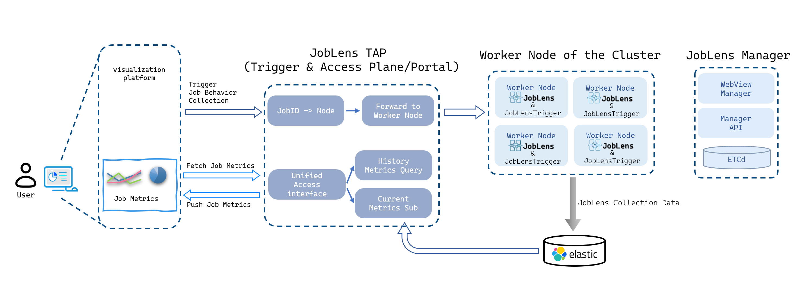

<div align="center">

# Nagato Hikari

**Job-native observability & workload profiling for HTC/HPC**

把监控粒度从节点下沉到作业：让每个作业的资源使用、I/O 行为与工作进度都可测量、可比较、可复用。

[](https://github.com/joblens-org/JobLens)
[](https://github.com/joblens-org/JobLens/blob/main/LICENSE)
[](mailto:wangzhenyuan@ihep.ac.cn)

</div>

---

## 🌟 关于我

- 🔬 中国科学院高能物理研究所计算中心（CC.IHEP.CAS），博士研究
- 🎯 主线工作：**JobLens** —— 面向 HTC/HPC 的 Job-Native 分布式作业监控与性能分析 Agent
- 🧭 在研究：工作进度条件化的批作业性能画像；HTC/HPC what-if 仿真
- 📍 北京
- ⚡ 从自动化跨到计算机，懂一点电子信息技术与控制原理

---

## 🔭 主线工作：JobLens

[JobLens](https://github.com/joblens-org/JobLens) 是一套面向 HTC/HPC 集群的作业级可观测性系统。它在计算节点上用 eBPF 采集，把资源指标精确归因到具体作业，并通过统一的控制面支持按需采集与查询。

| 维度 | 内容 |
|---|---|
| **采集** | eBPF/内核事件为主：CPU/内存、syscall I/O、文件元数据、网络；功耗（RAPL/IPMI）、GPU（NVML） |
| **归因** | HTCondor / Slurm / cgroup；PID → Job 映射与作业生命周期事件 |
| **输出** | File / Elasticsearch / Kafka / Prometheus 多种 writer，按采集器路由 |
| **控制面** | Trigger（Flask）提供 REST API 与 Lua 规则引擎，按作业特征动态选择采集器 |
| **部署** | 统一 RPM + systemd，AlmaLinux 9；C++ 实现，Apache-2.0 |
| **生产验证** | IHEP 生产节点：256 核 / 251 个 HTCondor 作业时 **CPU < 0.15%**、**RSS ~145 MB** |



**相关链接**：[源码](https://github.com/joblens-org/JobLens) · [API 文档](https://github.com/joblens-org/JobLens/blob/main/doc/api_documentation.md) · [部署套件](https://github.com/joblens-org/JobLens/blob/main/doc/joblens_simplest_deployable_suite.md) · [Releases](https://github.com/joblens-org/JobLens/releases)

---

## 🧪 在研究

> 以下为在研方向，当前处于方法梳理、测量契约与文献基线阶段，尚无实验结论。

**工作进度条件化的批作业性能画像**
面向反复运行的 HTC 作业，研究"已完成多少工作"这一维度如何进入作业画像，以及它能否在同等启动延迟预算下改善剩余时长预测与错峰决策。关注工作、环境与响应的分离，以及信息可得时刻对预测的约束。

**真实画像驱动的 what-if 仿真**
用采集到的作业画像驱动 SimGrid / WRENCH 一类的仿真，评估调度与资源配置策略，目标是让画像成为可校准的仿真输入，而不是另建一套脱离测量的模型。

---

## 🛠️ 技术栈

**语言**


**系统与采集**


**集群调度与 HPC**


**数据与基础设施**


**服务与前端**


---

## 📈 GitHub 数据


---

## 🌱 最近动态

- 🔭 **2026-09** JobLens v0.3.6 发布：拆分采集器调度、统一 RPM 打包、完善 Trigger 生命周期
- 📚 **2026-10** 完成工作进度条件化画像的文献基线与学习综述（121 篇 PDF，29 篇精读）
- 🧩 **2026-10** 梳理 JobLens 事件信号路径，规划作业粒度的事件采集与写出链路

---

## 🤝 联系我

[](mailto:wangzhenyuan@ihep.ac.cn)
[](https://github.com/nowzycc)

---

## 📊 编码时间

<!--START_SECTION:waka-->


**🐱 My GitHub Data** 

> 📦 11.6 kB Used in GitHub's Storage 
> 
> 🏆 443 Contributions in the Year 2026
> 
> 🚫 Not Opted to Hire
> 
> 📜 6 Public Repositories 
> 
> 🔑 4 Private Repositories
> 
**I'm a Night 🦉** 

```text
🌞 Morning                48 commits          ██░░░░░░░░░░░░░░░░░░░░░░░   09.90 % 
🌆 Daytime                161 commits         ████████░░░░░░░░░░░░░░░░░   33.20 % 
🌃 Evening                239 commits         ████████████░░░░░░░░░░░░░   49.28 % 
🌙 Night                  37 commits          ██░░░░░░░░░░░░░░░░░░░░░░░   07.63 % 
```
📅 **I'm Most Productive on Tuesday** 

```text
Monday                   87 commits          ████░░░░░░░░░░░░░░░░░░░░░   17.94 % 
Tuesday                  105 commits         █████░░░░░░░░░░░░░░░░░░░░   21.65 % 
Wednesday                48 commits          ██░░░░░░░░░░░░░░░░░░░░░░░   09.90 % 
Thursday                 75 commits          ████░░░░░░░░░░░░░░░░░░░░░   15.46 % 
Friday                   31 commits          ██░░░░░░░░░░░░░░░░░░░░░░░   06.39 % 
Saturday                 83 commits          ████░░░░░░░░░░░░░░░░░░░░░   17.11 % 
Sunday                   56 commits          ███░░░░░░░░░░░░░░░░░░░░░░   11.55 % 
```


📊 **This Week I Spent My Time On** 

```text
🕑︎ Time Zone: Asia/Hong_Kong

💬 Programming Languages: 
Markdown                 3 hrs 25 mins       █████████░░░░░░░░░░░░░░░░   35.68 % 
Other                    3 hrs 1 min         ████████░░░░░░░░░░░░░░░░░   31.41 % 
HTML                     1 hr 23 mins        ████░░░░░░░░░░░░░░░░░░░░░   14.40 % 
Python                   58 mins             ███░░░░░░░░░░░░░░░░░░░░░░   10.12 % 
C++                      22 mins             █░░░░░░░░░░░░░░░░░░░░░░░░   03.83 % 

🔥 Editors: 
VS Code                  4 hrs 57 mins       █████████████░░░░░░░░░░░░   51.58 % 
Opencode Cli             2 hrs 47 mins       ███████░░░░░░░░░░░░░░░░░░   28.99 % 
Codex Vscode             1 hr 45 mins        █████░░░░░░░░░░░░░░░░░░░░   18.24 % 
OpenCode                 6 mins              ░░░░░░░░░░░░░░░░░░░░░░░░░   01.19 % 

💻 Operating System: 
WSL                      9 hrs 37 mins       █████████████████████████   100.00 % 
```

**I Mostly Code in Python** 

```text
Python                   10 repos            ███████████░░░░░░░░░░░░░░   45.45 % 
C                        2 repos             ██░░░░░░░░░░░░░░░░░░░░░░░   09.09 % 
Makefile                 1 repo              █░░░░░░░░░░░░░░░░░░░░░░░░   04.55 % 
Jupyter Notebook         1 repo              █░░░░░░░░░░░░░░░░░░░░░░░░   04.55 % 
C++                      1 repo              █░░░░░░░░░░░░░░░░░░░░░░░░   04.55 % 
```


**Timeline**


 Last Updated on 19/10/2026 23:08:50 UTC
<!--END_SECTION:waka-->
