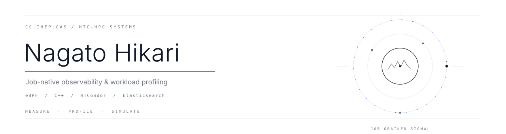
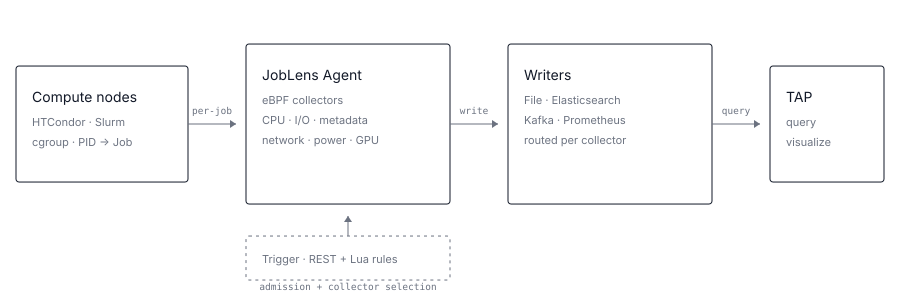
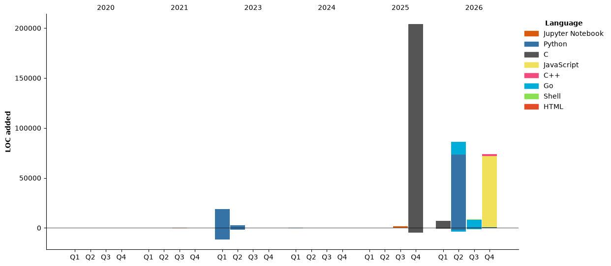

<p align="center">
  <picture>
    <source media="(prefers-color-scheme: dark)" srcset="https://raw.githubusercontent.com/nowzycc/nowzycc/main/assets/hero-dark.svg">
    
  </picture>
</p>

## About

I work on job-level observability and performance analysis for HTC/HPC clusters. The goal is to move monitoring from the node down to the job: making each job's resource use, I/O behavior and work progress measurable, comparable and reusable.

PhD researcher at the Computing Center, Institute of High Energy Physics, Chinese Academy of Sciences (CC.IHEP.CAS), Beijing.

```console
$ joblens --whoami
role      PhD researcher @ CC.IHEP.CAS
focus     job-level observability · workload profiling · what-if simulation
stack     eBPF / C++ / HTCondor / Elasticsearch
status    building job-grained event collection
```

## Work

### JobLens

[JobLens](https://github.com/joblens-org/JobLens) is a job-native observability system for HTC/HPC clusters. Agents on compute nodes collect with eBPF and attribute resource data to individual jobs; a unified control plane handles on-demand collection and query.

<p align="center">
  <picture>
    <source media="(prefers-color-scheme: dark)" srcset="https://raw.githubusercontent.com/nowzycc/nowzycc/main/assets/joblens-flow-dark.svg">
    
  </picture>
</p>

| Area | Detail |
|:---|:---|
| **Scope** | CPU, memory, syscall I/O, file metadata, network; power (RAPL/IPMI), GPU (NVML) |
| **Attribution** | HTCondor, Slurm, cgroup; PID → job mapping and lifecycle events |
| **Output** | File, Elasticsearch, Kafka, Prometheus; routed per collector |
| **Control plane** | Trigger (Flask): REST API and Lua rule engine for admission and collector selection |
| **Delivery** | C++ / CMake / systemd / unified RPM; AlmaLinux 9; Apache-2.0 |
| **Production** | Validated at IHEP: 256 cores, 251 HTCondor jobs, CPU < 0.15%, RSS ~145 MB |

[Source](https://github.com/joblens-org/JobLens) · [API](https://github.com/joblens-org/JobLens/blob/main/doc/api_documentation.md) · [Deployment](https://github.com/joblens-org/JobLens/blob/main/doc/joblens_simplest_deployable_suite.md) · [Releases](https://github.com/joblens-org/JobLens/releases)

## Research

Two threads, both in progress. No experimental results yet.

### Work-progress-conditioned profiling

For recurring HTC workloads, I study how "how much work has been completed" can enter a job profile, and whether it improves remaining-time prediction and start-time staggering under the same delay budget. The work separates demand, environment and response, and respects what information is available at each point in time.

### Profile-driven what-if simulation

Using collected profiles to drive SimGrid / WRENCH-style simulation, so that profiles become calibrated simulation inputs rather than a separate, measurement-free model.

## Stack

| Area | Detail |
|:---|:---|
| **Languages** | C++ · Python · Bash |
| **Systems** | eBPF · Linux · CMake · systemd |
| **Scheduling** | HTCondor · Slurm · cgroup |
| **Data** | Elasticsearch · Kafka · Prometheus |
| **Services** | FastAPI · Vue · Docker · Kubernetes |

## GitHub

<p align="center">
  <picture>
    <source media="(prefers-color-scheme: dark)" srcset="https://github-readme-stats.vercel.app/api?username=nowzycc&show_icons=true&hide_rank=true&hide_border=true&bg_color=0D1117&title_color=F0F6FC&icon_color=8B949E&text_color=8B949E&cache_seconds=86400">
    
  </picture>
</p>

<p align="center">
  <picture>
    <source media="(prefers-color-scheme: dark)" srcset="https://streak-stats.demolab.com?user=nowzycc&theme=dark&background=0D1117&border=0D1117&stroke=21262D&ring=F0F6FC&fire=F0F6FC&currStreakNum=F0F6FC&sideNums=F0F6FC&currStreakLabel=8B949E&sideLabels=8B949E&dates=8B949E">
    
  </picture>
</p>

<p align="center">
  <picture>
    <source media="(prefers-color-scheme: dark)" srcset="https://raw.githubusercontent.com/nowzycc/nowzycc/output/github-snake-dark.svg">
    <source media="(prefers-color-scheme: light)" srcset="https://raw.githubusercontent.com/nowzycc/nowzycc/output/github-snake.svg">
    
  </picture>
</p>

## Contact

[Email](mailto:wangzhenyuan@ihep.ac.cn) · [GitHub](https://github.com/nowzycc) · [JobLens](https://github.com/joblens-org/JobLens)

<details>
<summary>WakaTime stats</summary>

<!--START_SECTION:waka-->


**🐱 My GitHub Data** 

> 📦 12.9 kB Used in GitHub's Storage 
 > 
> 🏆 681 Contributions in the Year 2026
 > 
> 🚫 Not Opted to Hire
 > 
> 📜 9 Public Repositories 
 > 
> 🔑 4 Private Repositories 
 > 
**I'm a Night 🦉** 

```text
🌞 Morning                82 commits          ████░░░░░░░░░░░░░░░░░░░░░   15.05 % 
🌆 Daytime                173 commits         ████████░░░░░░░░░░░░░░░░░   31.74 % 
🌃 Evening                253 commits         ████████████░░░░░░░░░░░░░   46.42 % 
🌙 Night                  37 commits          ██░░░░░░░░░░░░░░░░░░░░░░░   06.79 % 
```
📅 **I'm Most Productive on Thursday** 

```text
Monday                   88 commits          ████░░░░░░░░░░░░░░░░░░░░░   16.15 % 
Tuesday                  111 commits         █████░░░░░░░░░░░░░░░░░░░░   20.37 % 
Wednesday                49 commits          ██░░░░░░░░░░░░░░░░░░░░░░░   08.99 % 
Thursday                 121 commits         ██████░░░░░░░░░░░░░░░░░░░   22.20 % 
Friday                   35 commits          ██░░░░░░░░░░░░░░░░░░░░░░░   06.42 % 
Saturday                 83 commits          ████░░░░░░░░░░░░░░░░░░░░░   15.23 % 
Sunday                   58 commits          ███░░░░░░░░░░░░░░░░░░░░░░   10.64 % 
```


📊 **This Week I Spent My Time On** 

```text
🕑︎ Time Zone: Asia/Hong_Kong

💬 Programming Languages: 
Other                    13 hrs 44 mins      ██████████░░░░░░░░░░░░░░░   40.41 % 
Markdown                 12 hrs 11 mins      █████████░░░░░░░░░░░░░░░░   35.85 % 
RPMSpec                  3 hrs 7 mins        ██░░░░░░░░░░░░░░░░░░░░░░░   09.17 % 
Python                   2 hrs 1 min         █░░░░░░░░░░░░░░░░░░░░░░░░   05.93 % 
C++                      53 mins             █░░░░░░░░░░░░░░░░░░░░░░░░   02.61 % 

🔥 Editors: 
VS Code                  21 hrs 57 mins      ████████████████░░░░░░░░░   64.57 % 
OpenCode                 7 hrs 19 mins       █████░░░░░░░░░░░░░░░░░░░░   21.54 % 
Codex Vscode             3 hrs 43 mins       ███░░░░░░░░░░░░░░░░░░░░░░   10.94 % 
Opencode Cli             1 hr                █░░░░░░░░░░░░░░░░░░░░░░░░   02.95 % 

💻 Operating System: 
WSL                      34 hrs              █████████████████████████   100.00 % 
```

**I Mostly Code in Python** 

```text
Python                   10 repos            ██████████░░░░░░░░░░░░░░░   40.00 % 
JavaScript               2 repos             ██░░░░░░░░░░░░░░░░░░░░░░░   08.00 % 
C                        2 repos             ██░░░░░░░░░░░░░░░░░░░░░░░   08.00 % 
Makefile                 1 repo              █░░░░░░░░░░░░░░░░░░░░░░░░   04.00 % 
Jupyter Notebook         1 repo              █░░░░░░░░░░░░░░░░░░░░░░░░   04.00 % 
```


**Timeline**




 Last Updated on 28/11/2026 02:23:07 UTC
<!--END_SECTION:waka-->

</details>

<p align="center">
  <picture>
    <source media="(prefers-color-scheme: dark)" srcset="https://raw.githubusercontent.com/nowzycc/nowzycc/main/assets/footer-dark.svg">
    
  </picture>
</p>
